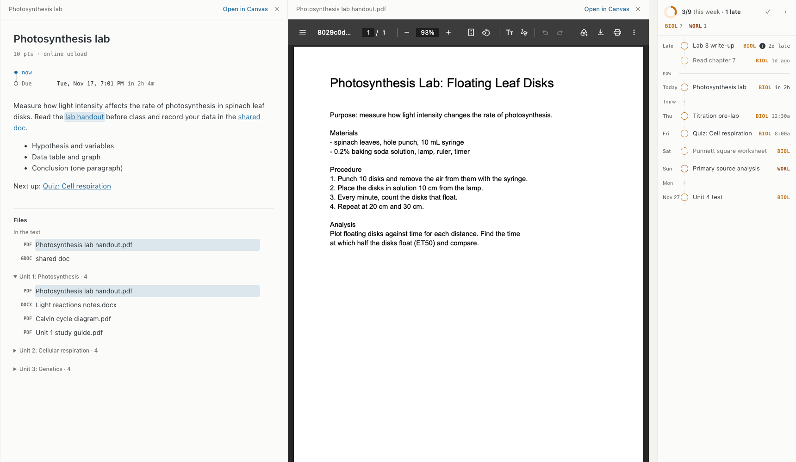
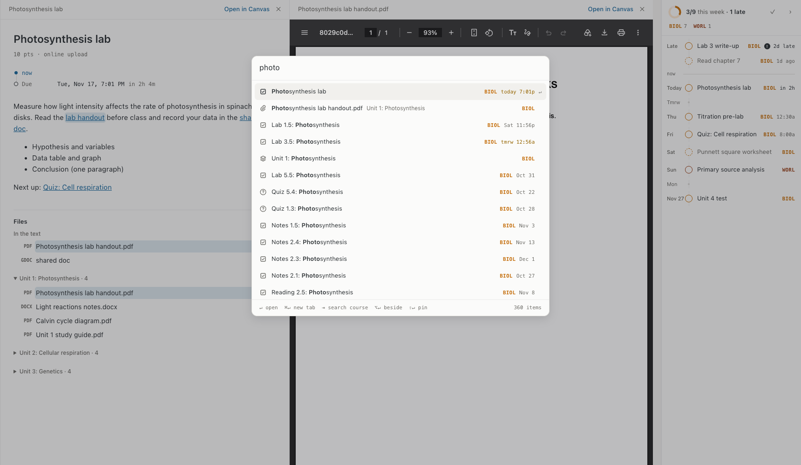

# Quickstudy

Fast, side-by-side workspace for Canvas LMS.

## Install

1. Clone this repository.
2. In `chrome://extensions`, enable **Developer mode** and **Load unpacked** the `extension/` folder.
3. Open Canvas.

[Guide](docs/GUIDE.md) · Not affiliated with Instructure.
